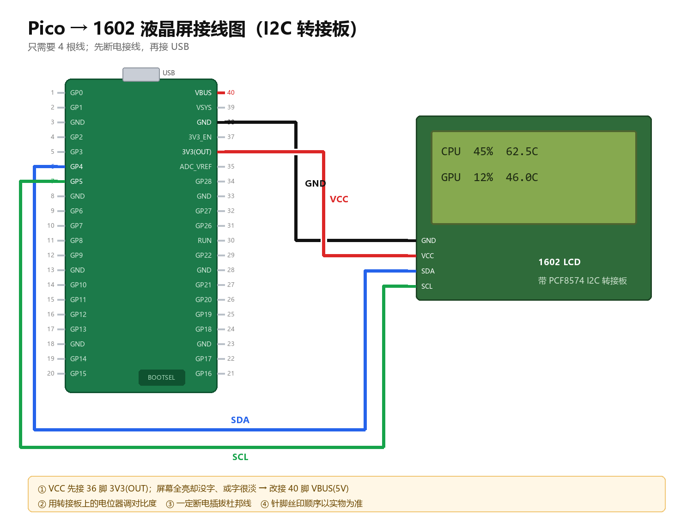

# Pico + 1602 LCD 显示电脑 CPU / GPU 占用率与温度

## 一、接线（1602 带 I2C 转接板 / PCF8574）



| 1602 转接板 | Pico 物理引脚 | Pico 丝印 |
|---|---|---|
| GND | 38 脚 | GND |
| VCC | 36 脚 | 3V3(OUT) —— 屏幕空白/字淡时改接 40 脚 VBUS(5V) |
| SDA | 6 脚 | GP4 |
| SCL | 7 脚 | GP5 |

四根线即可。转接板背面可调电位器 = 对比度，**屏幕全亮无字先转它**。
接线顺序：先断电接线，再插 USB。

### 如果是 16 脚纯并口（没有转接板）

| 1602 引脚 | 接到 |
|---|---|
| 1 VSS | GND（38 脚） |
| 2 VDD | VBUS 5V（40 脚） |
| 3 V0 | 10k 电位器中间脚（两端接 5V / GND） |
| 4 RS | GP2（4 脚） |
| 5 RW | GND（只写，接地） |
| 6 E | GP3（5 脚） |
| 7~10 D0~D3 | 悬空不接 |
| 11 D4 | GP6（9 脚） |
| 12 D5 | GP7（10 脚） |
| 13 D6 | GP8（11 脚） |
| 14 D7 | GP9（12 脚） |
| 15 A | 5V 串 220Ω（模块已带电阻则直连） |
| 16 K | GND |

这种接法要换并口驱动，`pico_main.py` 不通用，需要另外改。

## 二、烧录 Pico 程序（Thonny）

1. Thonny → 右下角选择 `MicroPython (Raspberry Pi Pico)` → 解释器选 COM3（你的 Pico 就是 COM3「USB 串行设备」）。
2. 打开 `pico_main.py`。
3. 菜单 `文件 → 另存为… → Raspberry Pi Pico`，文件名填 **`main.py`**（覆盖旧的）。
4. 拔插一次 USB（让 main.py 自启）。

此时屏上应显示 `PC Monitor / waiting...`。

## 二、烧录 Pico 程序（已自动完成）

已经用串口把 `pico_main.py` 写进 Pico 的 `main.py` 并复位，上电自启，不需要再手动操作。
以后要重烧：`python -m mpremote connect COM3 fs cp pico_main.py :main.py` 然后 `python -m mpremote connect COM3 reset`。

> 注意：MicroPython 没有 `str.ljust()`，程序里已用自写的 `pad()` 补位。

## 三、电脑端

**双击 `start_monitor.bat`** 即可（内部就是 `python pc_stats.py -p COM3`）。
关闭那个黑窗口 = 停止发送。

命令行方式：

```powershell
python pc_stats.py -p COM3          # 或 python pc_stats.py 自动找口
python pc_stats.py --dry-run        # 只打印，验证取数是否正常
```

启动时会先发 `PING`，Pico 回 `PONG` 才打印「已握手」，说明链路真的通了。

## 四、CPU 温度（已装好）

`psutil` 在 Windows 上读不到 CPU 温度。已安装 **LibreHardwareMonitor 0.9.6**：

- 程序目录：`C:\Tools\LibreHardwareMonitor`
- 同时装了它要求的 **PawnIO** 内核驱动（读 MSR 用，`sc query PawnIO` 可查）
- 0.9.6 已经**删掉了 WMI 和 Web 服务**，所以走 `lhm_bridge.exe`：
  一个 40 行的 C# 程序，直接调 `LibreHardwareMonitorLib.dll`，输出一行 JSON
- **LHM 的界面不用开着**，驱动服务常驻即可；普通权限也能读，不需要管理员

```powershell
python pc_stats.py --diag     # 看 CPU/GPU 型号、温度、数据来源
```

改了驱动/库路径时，重新编译桥接程序：

```powershell
cd C:\Tools\LibreHardwareMonitor
C:\Windows\Microsoft.NET\Framework64\v4.0.30319\csc.exe /nologo /target:exe `
  /r:LibreHardwareMonitorLib.dll /out:lhm_bridge.exe lhm_bridge.cs
```

GPU 走 `nvidia-smi`，N 卡无需额外组件；AMD/Intel 显卡则用桥接程序里的 GPU 传感器。

## 五、显示效果

```
CPU  45%  62.5C
GPU  12%  46.0C
```

## 六、排查

| 现象 | 原因 |
|---|---|
| 屏全亮/全暗无字 | 转对比度电位器；确认 VCC 供电 |
| 只有一排黑方块，内容不出现 | 少数克隆板把数据线放在 P0~P3：把驱动里的 `_nibble` 改成发低半字节即可 |
| 屏亮但显示方块 | I2C 地址不对，程序会自动扫 0x27/0x3F；仍不行用 `i2c.scan()` 看地址 |
| 显示 `waiting...` 不变 | 电脑端没运行，或 Thonny 还占着串口 |
| 显示 `CPU -- no host` | 电脑端脚本崩了 / 串口断了，重跑 pc_stats.py |
| CPU 温度 `--.-C` | 桥接程序没找到或 PawnIO 驱动没跑：`python pc_stats.py --diag` |
| `OSError: [Errno 16]` 打不开串口 | Thonny 或另一个 python 还占用 COM3 |

## 七、协议

电脑每秒发一行 ASCII：`cpu%,cpu_temp,gpu%,gpu_temp`，未知值 `-1`。
例：`23,56.0,8,43.0`。想换显示内容只需改 `pico_main.py` 的 `fmt()`。
